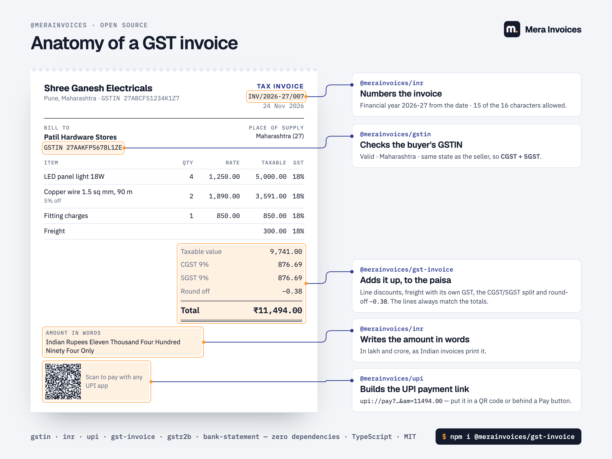
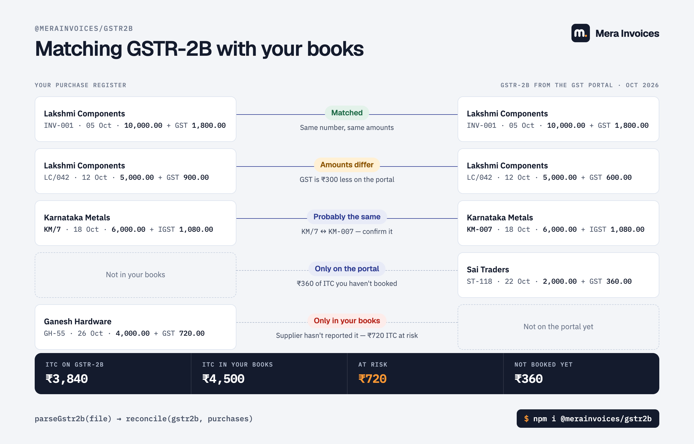
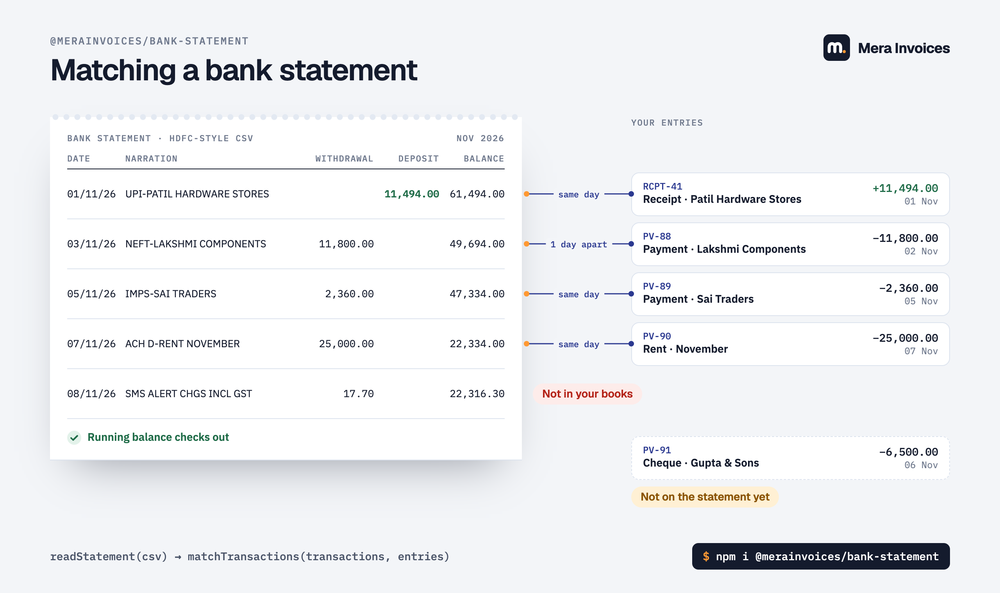

# Mera Invoices open-source toolkit

Small, dependency-free JavaScript packages for Indian GST billing: GSTINs, invoice maths, rupees in words, UPI links, GSTR-2B and bank statements.

[](https://github.com/merainvoices/oss/actions/workflows/ci.yml)


[](LICENSE)



| Package | What it does | |
| --- | --- | --- |
| [`@merainvoices/gstin`](packages/gstin) | Validate GSTINs with the check digit, read state and PAN, decide CGST + SGST or IGST | [](https://www.npmjs.com/package/@merainvoices/gstin) |
| [`@merainvoices/gst-invoice`](packages/gst-invoice) | Invoice maths: lines, CGST/SGST/IGST, freight, discount before or after GST, round-off — exact to the paisa | [](https://www.npmjs.com/package/@merainvoices/gst-invoice) |
| [`@merainvoices/inr`](packages/inr) | ₹1,23,456.00 formatting, amount in words (lakh and crore), April–March financial year, Rule 46 invoice numbers | [](https://www.npmjs.com/package/@merainvoices/inr) |
| [`@merainvoices/upi`](packages/upi) | Build and read `upi://pay` links for invoices and QR codes | [](https://www.npmjs.com/package/@merainvoices/upi) |
| [`@merainvoices/gstr2b`](packages/gstr2b) | Read the GSTR-2B JSON from the GST portal and match it against your purchase register | [](https://www.npmjs.com/package/@merainvoices/gstr2b) |
| [`@merainvoices/bank-statement`](packages/bank-statement) | Read Indian bank statement exports and match them against your own records | [](https://www.npmjs.com/package/@merainvoices/bank-statement) |

## A whole invoice in 25 lines

```sh
npm install @merainvoices/gstin @merainvoices/gst-invoice @merainvoices/inr @merainvoices/upi
```

```js
import { validateGSTIN, isInterStateSupply } from '@merainvoices/gstin'
import { computeInvoice } from '@merainvoices/gst-invoice'
import { formatInvoiceNumber, amountInWords, formatINR } from '@merainvoices/inr'
import { buildUpiLink } from '@merainvoices/upi'

const buyer = validateGSTIN('27aakfp5678l1ze')          // { valid: true, gstin: '27AAKFP5678L1ZE', … }
const interState = isInterStateSupply({ seller: { gstin: '27ABCFS1234K1Z7' }, buyer })   // false → CGST + SGST

const number = formatInvoiceNumber('INV/{yyyy-yy}/{n}', { seq: 7, date: '2026-11-24' })  // 'INV/2026-27/007'

const invoice = computeInvoice({
  items: [
    { qty: 4, rate: 1250, gstRate: 18 },
    { qty: 2, rate: 1890, discountPercent: 5, gstRate: 18 },
    { qty: 1, rate: 850, gstRate: 18 },
  ],
  interState,
  freight: { amount: 300, gstRate: 18 },
  roundOff: true,
})

formatINR(invoice.total)       // '₹11,494.00'   (CGST 876.69 + SGST 876.69, round-off −0.38)
amountInWords(invoice.total)   // 'Indian Rupees Eleven Thousand Four Hundred Ninety Four Only'
buildUpiLink({ vpa: 'shop@okaxis', name: 'Shree Ganesh Electricals', amount: invoice.total, ref: number })
// 'upi://pay?pa=shop%40okaxis&pn=Shree%20Ganesh%20Electricals&am=11494.00&tr=INV%2F2026-27%2F007&cu=INR'
```

That's the invoice in the picture above. The full script is [`examples/full-invoice.mjs`](examples/full-invoice.mjs).

## Matching GSTR-2B with your books



```js
import { parseGstr2b, reconcile } from '@merainvoices/gstr2b'

const result = reconcile(parseGstr2b(fileText), purchases)
result.onlyBooks        // bills your suppliers haven't reported: that ITC is at risk
result.summary.atRiskTax
```

[`examples/gstr2b-reconcile.mjs`](examples/gstr2b-reconcile.mjs) · [package docs](packages/gstr2b)

## Matching a bank statement



```js
import { readStatement, matchTransactions } from '@merainvoices/bank-statement'

const { transactions } = readStatement(csvText)          // finds the table, reads day-first dates and Cr/Dr
const { matches, unmatchedTransactions } = matchTransactions(transactions, entries)
```

[`examples/bank-statement.mjs`](examples/bank-statement.mjs) · [package docs](packages/bank-statement)

## Why these packages

- **Exact to the paisa.** Invoice maths is done in whole paise. The lines always add up to the totals, CGST + SGST always equals the GST, and half a paisa always rounds up, even where floating-point maths would round it down. The tests check this on 500 random invoices.
- **Indian rules built in.** Day-first dates, lakh and crore, the April–March financial year in India time, the 16-character invoice-number rule, SEZ supplies as IGST, the GSTIN check digit.
- **No dependencies.** Plain ESM that runs in Node 18+, browsers, React Native and edge runtimes, with TypeScript types.
- **Nothing leaves your machine.** No network calls, no portal logins, no API keys.
- **Signed builds.** Releases are published from GitHub Actions with npm provenance, so you can check that a package was built from this repository.

The code comes from [Mera Invoices](https://merainvoices.com), a GST billing app.

## Examples

[`examples/`](examples) has runnable scripts, including GSTIN messages in Hindi. CI runs every example, so they stay correct.

```sh
git clone https://github.com/merainvoices/oss && cd oss
npm install          # links the packages; nothing is downloaded
node examples/full-invoice.mjs
```

## Develop

```sh
npm install         # links the workspace packages
npm test            # every package and every example
npm run pack:check  # what each package would publish
```

See [CONTRIBUTING.md](CONTRIBUTING.md). Report security problems privately, as described in [SECURITY.md](SECURITY.md).

## Not tax advice

These packages check, calculate and match data. They don't file returns or decide what tax applies to you. Confirm GST treatment with a chartered accountant.

## Licence

[MIT](LICENSE) © REKSMART Insights Private Limited
