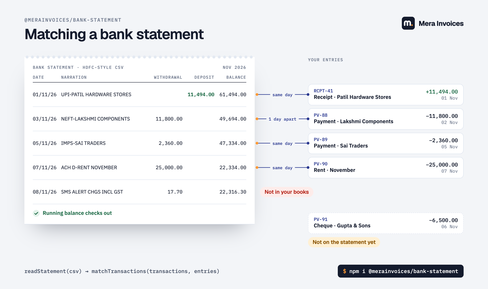

# @merainvoices/bank-statement

Read the statement export from an Indian bank and match it against your own records: receipts, payments, vouchers.

It finds the table under the account details, works out which column is which, reads day-first dates and amounts like `1,23,456.78 Cr`, and pairs each transaction with your entry by direction, amount and date.

Zero dependencies. Works in Node 18+, browsers and edge runtimes. Ships with TypeScript types.



```sh
npm install @merainvoices/bank-statement
```

## Read a statement

```js
import { readStatement } from '@merainvoices/bank-statement'

const { transactions } = readStatement(csvText)
// [{ row: 4, date: '2026-08-01', description: 'UPI-RAVI KUMAR TRADERS-PAYMENT', reference: '0000123',
//    moneyIn: 18880, moneyOut: 0, balance: 142880 }, …]
```

`readStatement` takes CSV text, or rows (`unknown[][]`) from a spreadsheet library. For Excel files, read the sheet into rows first, for example with [SheetJS](https://sheetjs.com):

```js
const rows = XLSX.utils.sheet_to_json(workbook.Sheets[workbook.SheetNames[0]], { header: 1, raw: true })
const { transactions } = readStatement(rows)
```

Spreadsheet date numbers (like `46239`) and `Date` objects are read as dates.

It throws an `Error` with `code: 'NO_HEADER'` when it can't find a table with a date column and either debit and credit columns or an amount column. Pass `{ headerRow, columns }` to say where they are yourself.

### Layouts it reads

- **Separate withdrawal and deposit columns** (like HDFC): `Withdrawal Amt.` / `Deposit Amt.`, `Debit` / `Credit`, `Paid out` / `Paid in`.
- **One amount column with a Dr/Cr column** (like SBI): `Amount` + `Dr/Cr`, `Debit/Credit` or `Type`. `CR`/`DR` and `Credit`/`Debit` are both understood.
- **One amount column with a suffix** (`5,000.00 Cr`) **or a sign** (`-5,000` is money out).

Column names are matched loosely ("Txn Date", "Transaction Date", "Value Date"; "Narration", "Particulars", "Transaction Remarks"; "Withdrawal Amount (INR)"…).

The tests use HDFC-style and SBI-style layouts. If your bank's export doesn't read correctly, pass the column positions yourself, and please [open an issue](https://github.com/merainvoices/oss/issues) with the header row (no account data).

### Dates and amounts

- Dates are **day first**: `05/08/26` is 5 August 2026. `05-Aug-2026`, `05.08.2026` and ISO dates also work.
- Impossible dates like `31/02/2026` are rejected, not rolled over.
- Amounts accept `₹`, `Rs.`, `INR`, Indian commas, brackets for negatives, and `Cr`/`Dr` suffixes.
- A balance marked `Dr` (overdrawn) comes back negative.

## Check the running balance

```js
import { checkRunningBalance } from '@merainvoices/bank-statement'

checkRunningBalance(transactions)
// { ok: true, order: 'oldest-first', mismatches: [] }
```

Each balance should equal the previous balance plus money in, minus money out. A mismatch usually means a column was read wrongly or a row is missing. Statements listed newest first are detected.

## Match against your records

```js
import { matchTransactions } from '@merainvoices/bank-statement'

const entries = [
  { id: 'RCPT-31', direction: 'in', amount: 18880, date: '2026-08-01' },   // money into this account
  { id: 'PV-12', direction: 'out', amount: 25000, date: '2026-08-02' },    // money out of it
]

const { matches, unmatchedTransactions, unmatchedEntries } = matchTransactions(transactions, entries, { toleranceDays: 3 })
// matches: [{ transaction, entry, dayGap }]
```

A pair needs:
- the same direction,
- the same amount to the paisa,
- dates no more than `toleranceDays` apart (default 3).

Each transaction and each entry is used at most once. The closest dates are paired first across the whole statement, so a same-day entry is never taken by a transaction two days away. Your entries come back with any extra fields you gave them.

## Lower-level functions

`parseCsv(text, { delimiter })`, `findHeaderRow(rows)`, `guessColumns(headerCells)`, `hasRequiredColumns(columns)`, `readTransactions(rows, headerRow, columns)`, `parseDate(value)`, `parseAmount(value)`.

## Recipes

### Entries from your ledger

Direction is from the bank account's side: money received into the account is `'in'`, money paid out of it is `'out'`.

```js
const entries = ledgerLines.map((line) => ({
  id: line.voucherNo,
  direction: line.debit > 0 ? 'in' : 'out',    // a debit to the bank account is money in
  amount: line.debit || line.credit,
  date: line.date,                             // 'YYYY-MM-DD'
}))
```

### Your bank names its columns differently

```js
readStatement(rows, { headerRow: 4, columns: { date: 0, description: 2, debit: 5, credit: 6, balance: 7 } })
```

Any column you don't name is still guessed from the header.

Full script: [`examples/bank-statement.mjs`](https://github.com/merainvoices/oss/blob/main/examples/bank-statement.mjs).

## Privacy

Everything runs where you call it. Nothing is sent anywhere.

Part of the [Mera Invoices toolkit](https://github.com/merainvoices/oss): [gstin](https://www.npmjs.com/package/@merainvoices/gstin) · [gst-invoice](https://www.npmjs.com/package/@merainvoices/gst-invoice) · [inr](https://www.npmjs.com/package/@merainvoices/inr) · [upi](https://www.npmjs.com/package/@merainvoices/upi) · [gstr2b](https://www.npmjs.com/package/@merainvoices/gstr2b) · [bank-statement](https://www.npmjs.com/package/@merainvoices/bank-statement).

## Licence

MIT © REKSMART Insights Private Limited. From [Mera Invoices](https://merainvoices.com), GST billing for Indian businesses.
