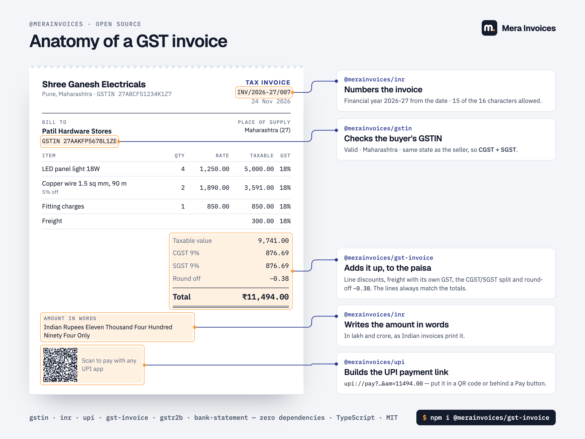

# @merainvoices/gst-invoice

The money on an Indian GST invoice: line items, CGST + SGST or IGST, freight with its own GST, a discount on the whole invoice (before or after GST), and round-off.

Everything is calculated in whole paise, so the lines always add up to the invoice totals exactly.

Zero dependencies. Works in Node 18+, browsers, React Native and edge runtimes. Ships with TypeScript types.



```sh
npm install @merainvoices/gst-invoice
```

## Use

```js
import { computeInvoice } from '@merainvoices/gst-invoice'

const invoice = computeInvoice({
  items: [
    { qty: 2, rate: 1250, gstRate: 18 },
    { qty: 10, rate: 85.5, discountPercent: 5, gstRate: 5 },
  ],
  interState: false,                       // CGST + SGST
  freight: { amount: 300, gstRate: 18 },
  discount: { type: 'percent', value: 10, beforeGst: true },
  roundOff: true,
})

invoice.taxable   // 3281.02
invoice.cgst      // 247.78
invoice.sgst      // 247.77
invoice.tax       // 495.55
invoice.roundOff  // 0.43
invoice.total     // 3777
invoice.lines[1]  // { taxable: 731.02, documentDiscount: 81.23, cgst: 18.28, sgst: 18.27, total: 767.57, … }
```

To decide `interState`, use [`isInterStateSupply` from `@merainvoices/gstin`](https://github.com/merainvoices/oss/tree/main/packages/gstin#cgst--sgst-or-igst).

## Rules

**Each line:** quantity × rate, less the line's discount, is the taxable value. GST is the rate on the taxable value, rounded to the paisa.
- A rupee discount (`discountAmount`) wins over a percentage (`discountPercent`) and can't exceed the line.
- Intra-state GST splits into CGST and SGST. When the GST is an odd number of paise, CGST takes the extra paisa, so CGST + SGST always equals the GST.
- Half a paisa rounds up, even where floating-point maths would round it down (0.5 × ₹1,053.35 = ₹526.675 → ₹526.68).

**Freight** has its own GST rate. It's added to the totals and is not affected by the invoice discount.

**Discount on the whole invoice** (`discount`), as a percentage or an amount:
- *Before GST* comes off the items' taxable value. It's shared across the lines in proportion to their taxable value, to the paisa, and GST is recalculated on each line. Every line reports its share in `documentDiscount`.
- *After GST* comes off the final total. The taxable value and GST don't change.

**Round-off:** `true` rounds the total to the nearest rupee (₹0.50 rounds up). A number sets the adjustment yourself, e.g. `-0.5`.

**No GST** (`noTax: true`): for documents that charge no GST, such as a bill of supply or an export under LUT. Rates are ignored, including freight's.

**Guarantees, on every invoice:**
- the lines add up to `items` for every figure,
- `cgst + sgst + igst === tax`,
- `taxable + tax − (after-GST discount) + roundOff === total`.

The tests check these on 500 random invoices.

## Output

| Field | Meaning |
| --- | --- |
| `lines[]` | `gross`, `discount`, `documentDiscount`, `taxable`, `gstRate`, `cgstRate`/`cgst`, `sgstRate`/`sgst`, `igstRate`/`igst`, `tax`, `total` |
| `items` | the lines added up |
| `freight` | `amount`, `gstRate`, `cgst`, `sgst`, `igst`, `tax`, `total` |
| `discount` | `type`, `value`, `beforeGst`, `amount` (the invoice discount; `type` is `null` when there is none) |
| `taxable`, `cgst`, `sgst`, `igst`, `tax` | items and freight together |
| `roundOff`, `total` | what the customer pays |

`computeLine(item, { interState, noTax })` gives the amounts for a single line.

## Input checks

Numbers may be given as numbers or numeric strings; blank values count as 0. A negative amount, a percentage over 100, or anything that isn't a number throws a `RangeError` naming the field, e.g. `items[2].qty cannot be negative`. Credit notes use positive amounts, like invoices.

## Not covered

Compensation cess, TCS, tax-inclusive prices and foreign-currency invoices.

## Recipes

### IGST or CGST + SGST from the GSTINs

```js
import { isInterStateSupply } from '@merainvoices/gstin'

const invoice = computeInvoice({
  items,
  interState: isInterStateSupply({ seller: { gstin: '27ABCFS1234K1Z7' }, buyer: { gstin: buyerGstin, sez: buyerIsSez } }),
})
```

### An export under LUT, or a bill of supply

```js
computeInvoice({ items, noTax: true })   // no GST on any line or on freight
```

### Print the discount line only when there is one

```js
if (invoice.discount.amount) {
  const label = invoice.discount.type === 'percent' ? `Discount ${invoice.discount.value}%` : 'Discount'
  rows.push([label, -invoice.discount.amount])
}
```

### Store the figures

Every figure comes back rounded to the paisa, so it fits a `NUMERIC(14,2)` column as it is. To store whole paise instead, use `Math.round(value * 100)`.

The whole flow, with GSTIN check, invoice number, amount in words and UPI link: [`examples/full-invoice.mjs`](https://github.com/merainvoices/oss/blob/main/examples/full-invoice.mjs).

Part of the [Mera Invoices toolkit](https://github.com/merainvoices/oss): [gstin](https://www.npmjs.com/package/@merainvoices/gstin) · [gst-invoice](https://www.npmjs.com/package/@merainvoices/gst-invoice) · [inr](https://www.npmjs.com/package/@merainvoices/inr) · [upi](https://www.npmjs.com/package/@merainvoices/upi) · [gstr2b](https://www.npmjs.com/package/@merainvoices/gstr2b) · [bank-statement](https://www.npmjs.com/package/@merainvoices/bank-statement).

## Licence

MIT © REKSMART Insights Private Limited. From [Mera Invoices](https://merainvoices.com), GST billing for Indian businesses.

This library does arithmetic. It doesn't decide which rate or treatment applies to a supply. That's for you and your chartered accountant.
