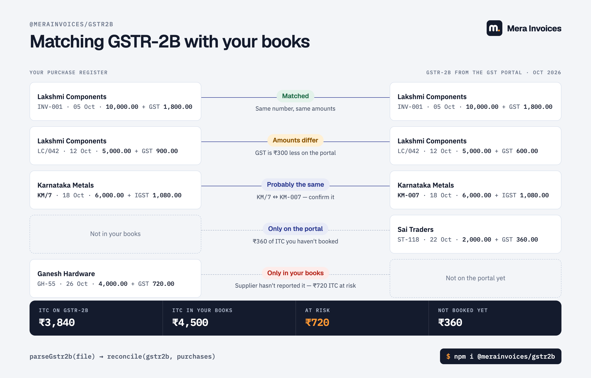

# @merainvoices/gstr2b

Read the GSTR-2B JSON you download from the GST portal and match it against your purchase register: which bills match, which differ, which are missing from your books, and which your suppliers haven't reported yet.

Runs in the browser or on a server. No GSP, no portal login, no dependencies. Ships with TypeScript types.



```sh
npm install @merainvoices/gstr2b
```

## Use

```js
import { parseGstr2b, reconcile } from '@merainvoices/gstr2b'

// The file from GST portal → Returns → GSTR-2B → Download JSON
const gstr2b = parseGstr2b(fileText)

const result = reconcile(gstr2b, [
  { id: 'bill-1', supplierGstin: '27AAAPL1234C1ZV', docNumber: 'INV/1', docDate: '2026-07-05',
    taxable: 10000, igst: 1800 },
  // …your purchase bills for the same month
])

result.matched        // same supplier and number, amounts agree
result.valueMismatch  // same supplier and number, amounts differ (taxableDiff, taxDiff)
result.probable       // same supplier, number matches once leading zeros are ignored ("INV-001" ↔ "INV/1")
result.only2b         // on the portal, not in your books
result.onlyBooks      // in your books, not on the portal yet — that ITC is at risk
result.summary        // counts and tax totals
```

Your bills come back in the results with any extra fields you passed (like `id`), so you can link back to your own records.

### Purchase record

| Field | Type | Notes |
| --- | --- | --- |
| `supplierGstin` | string | required; bills without it are skipped and counted |
| `docNumber` | string | the supplier's invoice number |
| `docDate` | string | `'YYYY-MM-DD'`, optional |
| `taxable` | number | taxable value |
| `igst`, `cgst`, `sgst` | number | default 0 |
| `itcEligible` | boolean | default `true` |
| `reverseCharge` | boolean | default `false` |

### Options

`reconcile(gstr2b, purchases, { tolerance: 1 })`: amounts within this many rupees count as equal (default ₹1, for rounding).

## How matching works

1. **Exact:** supplier GSTIN and document number, ignoring case, spaces and punctuation. Amounts are then compared within the tolerance.
2. **Probable:** supplier GSTIN and document number with leading zeros removed from each run of digits. A person should confirm these.

Each bill matches at most one portal row.

## What's read

- B2B and B2BA invoices, with item-level or document-level tax, and dd-mm-yyyy or dd/mm/yyyy dates, in every wrapper shape the portal has used.
- CDNR and CDNRA credit and debit notes: read and included in the summary, not matched.
- Invoice Management System status (`imsStatus`, where `'N'` means no action was taken) and e-invoice details (`irn`, `eInvoice`).
- Imports, SEZ imports and ISD entries are counted in `warnings`, not matched.

`parseGstr2b` throws an `Error` with `code` set to `INVALID_JSON`, `EMPTY` or `NOT_GSTR2B` and a message you can show to the user.

## Summary figures

All tax figures are IGST + CGST + SGST; cess is reported per row but not totalled.

| Field | Meaning |
| --- | --- |
| `itc2bAvailable` | tax on portal invoices marked ITC-available, minus credit notes, plus debit notes; reverse charge left out |
| `itcBooksEligible` | tax on your ITC-eligible bills, reverse charge left out |
| `matchedTax` | tax on matched rows |
| `atRiskTax` | tax on eligible bills the supplier hasn't reported |
| `missingFromBooksTax` | tax on ITC-available portal rows you haven't booked |
| `mismatchTax` | total of tax differences on value mismatches |

## Recipes

### In the browser

```js
fileInput.addEventListener('change', async (e) => {
  try {
    const gstr2b = parseGstr2b(await e.target.files[0].text())
    show(reconcile(gstr2b, purchases))
  } catch (err) {
    showError(err.message)   // readable: "This file is not valid JSON…", "No B2B invoices or credit notes found…"
  }
})
```

### From your database rows

```js
const purchases = rows.map((row) => ({
  id: row.id,
  supplierGstin: row.vendor_gstin,
  docNumber: row.bill_number,
  docDate: row.bill_date,
  taxable: row.taxable_amount,
  cgst: row.cgst_amount, sgst: row.sgst_amount, igst: row.igst_amount,
  itcEligible: row.itc_eligible,
}))
```

### A follow-up list for suppliers

```js
const csv = ['Supplier GSTIN,Bill,GST at risk',
  ...result.onlyBooks.map((b) => `${b.supplierGstin},${b.docNumber},${b.totalTax.toFixed(2)}`)].join('\n')
```

Full script: [`examples/gstr2b-reconcile.mjs`](https://github.com/merainvoices/oss/blob/main/examples/gstr2b-reconcile.mjs).

Part of the [Mera Invoices toolkit](https://github.com/merainvoices/oss): [gstin](https://www.npmjs.com/package/@merainvoices/gstin) · [gst-invoice](https://www.npmjs.com/package/@merainvoices/gst-invoice) · [inr](https://www.npmjs.com/package/@merainvoices/inr) · [upi](https://www.npmjs.com/package/@merainvoices/upi) · [gstr2b](https://www.npmjs.com/package/@merainvoices/gstr2b) · [bank-statement](https://www.npmjs.com/package/@merainvoices/bank-statement).

## Licence

MIT © REKSMART Insights Private Limited. From [Mera Invoices](https://merainvoices.com), GST billing for Indian businesses.

This library compares data you give it. It is not tax advice, and the ITC you claim is your decision. Confirm it with a chartered accountant.
